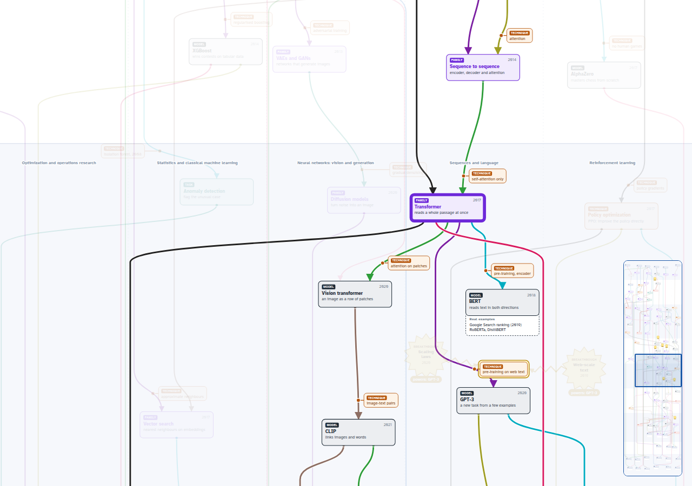

# AI Lineage: an interactive family tree of artificial intelligence

**Open the map:** https://will-hijazi.github.io/ai-lineage/

## What it is
AI Lineage maps the whole field of artificial intelligence across its history: from the older sciences it grew out
of, through the breakthroughs that changed its direction, to the assistants, agents and products in use today.

It brings together three views that are usually kept apart:

- **A timeline.** The field is laid out era by era, each with a short story of what changed and why.
- **A family tree.** Every idea is linked to where it came from and what it led to. Each link is labelled with the
  technique that carried over, so you see not only what came from what, but how.
- **A map of today.** Every line ends in real products and uses, from fraud detection and protein folding to AI
  assistants, autonomous agents and defense.

Together they answer what a timeline or a list alone cannot: where an idea came from, what it made possible, and
where it is at work now. The map is updated as the field moves, so new models and products can be placed in context
as soon as they appear.

## What it shows
AI did not start with computers, and it is not one line of progress. This map follows six older fields down to the
tools people use today:

- **Six columns**, each with its own roots: symbolic AI and search; optimization and operations research;
  statistics and classical machine learning; neural networks for vision and generation; sequences and language;
  reinforcement learning.
- **Nine eras**, from the roots (before 1956) through the birth of AI, learning from data, deep learning, attention
  and scale, assistants and agents, to defense and where it all landed today.
- **98 ideas** (fields, tasks, families, models, techniques and traps), joined by **123 links**. Every link that
  matters is labelled with the technique that carried over, such as *backpropagation*, *self-attention* or
  *human feedback (RLHF)*.
- **8 breakthroughs** drawn as starbursts (GPUs, ImageNet, the web, scaling laws, the Model Context Protocol and
  more), each striking the idea it made possible.
- **Real products** in dashed trays under the end boxes, from Stripe Radar and AlphaFold to Claude Code, Cowork-style
  work agents and the Pentagon's GenAI.mil.
- **A story for each era** in the side panel, which follows you as you scroll.

Lines cross columns often. That is the point: AlphaGo joins deep networks, reinforcement learning and tree search;
today's assistants join transformers, human feedback and tool use.

## How to use it
- **Click any box** to light its whole lineage: everything it came from and everything it led to. Click again, press
  Escape or use "Show everything" to clear.
- **Search** with the "Is it on the map?" box, or press `/`. Type a technique, family, model or product
  (*backprop*, *k-means*, *CNN*, *ChatGPT*, *RAG*, *Palantir*). The map glides to the box and lights its path. Column
  names such as *machine learning*, *NLP* or *RL* light a whole column. If something is not covered, it says so.
- **Move around** by dragging the map. Ctrl and wheel (or a pinch) zooms; the overview at the bottom right jumps
  anywhere.

It is a single self-contained web page: no installation, no tracking, works offline once downloaded.

## Please note
A personal study map, simplified by design; coverage through September 2026. Built with AI-enabled tools.
Corrections welcome: please open an issue. Recent product and defense facts are sourced in [SOURCES.md](SOURCES.md).

## License
- Content (the map, stories and images): [CC BY 4.0](LICENSE-CONTENT.md). Share and adapt it with credit.
- Code: [MIT](LICENSE).
- Font: Atkinson Hyperlegible by the Braille Institute, [SIL Open Font License 1.1](OFL-Atkinson-Hyperlegible.txt).

Suggested credit: *AI Lineage by Will Hijazi, CC BY 4.0, https://github.com/will-hijazi/ai-lineage*
